# Patrones de diseño

Con la popularización de los asistentes de código basados en inteligencia artificial (IA), como [GitHub Copilot](https://github.com/features/copilot) o [Claude Code](https://www.anthropic.com/claude-code), y de la llamada [programación *agéntica*](https://en.wikipedia.org/wiki/Agentic_AI) (en la que la IA no solo genera código, sino que planifica y ejecuta tareas de forma autónoma), el futuro de la ingeniería y el desarrollo de software parece estar en entredicho. Esto plantea varias preguntas:

- ¿Tiene el desarrollo de software la misma importancia que antes de la llegada de estas herramientas?
- ¿Es ahora más fácil o más difícil programar?
- ¿Siguen siendo válidas las competencias tradicionales de un desarrollador en la era de los asistentes de IA? Si no es así, ¿qué ha cambiado?

En los últimos años se ha publicado una gran cantidad de artículos de opinión sobre el papel de la profesión ante la expansión de los asistentes IA en todas las fases del desarrollo de software. Es difícil prever en qué se convertirá la profesión, y que rol tendrán los futuros ingenieros, pero algunos autores ofrecen pistas que, aunque no sean definitivas, merece la pena tener en cuenta. Osborn [@osborn2026] lo resume así:

> The future of software development will belong to those who can think clearly at scale, maintain durable mental models amid rapid change, and integrate machine-generated output into human-directed intent.

Es decir, el futuro pertenecerá a quienes sepan pensar con claridad a gran escala, mantener modelos mentales sólidos aunque todo cambie rápidamente e integrar el código generado por la IA en objetivos definidos por personas.

::: {.callout-tip title="Para reflexionar" icon=true}
¿Qué significa «pensar con claridad a gran escala»?
:::


Según el mismo autor, los asistentes de código actuales funcionan como una **memoria externa**: liberan al programador de recordar la sintaxis, escribir [código repetitivo](https://en.wikipedia.org/wiki/Boilerplate_code) (*boilerplate*) o memorizar cómo se usa cada [API](https://es.wikipedia.org/wiki/Interfaz_de_programaci%C3%B3n_de_aplicaciones), porque esas tareas las gestionan los asistentes IA. Al reducirse la carga de memoria para la programación, ganan peso sin embargo otras capacidades, como por ejemplo:

- el razonamiento,
- la comprensión de la arquitectura del sistema,
- el criterio para tomar decisiones,
- la conciencia de cómo está estructurado el código.


En consecuencia, lo que significa "saber programar" y "programar" está cambiando de forma drástica. Sin embargo, esto no implica que programar sea más fácil ni que el programador pierda relevancia en los proyectos de software. Los asistentes IA no eliminan el esfuerzo intelectual de programar, sino que lo **desplazan**: unas habilidades pasan a importar más que otras y, aunque desaparecen algunas barreras antiguas, surgen dificultades nuevas.

Por ejemplo, tareas críticas como la [depuración](https://en.wikipedia.org/wiki/Debugging) (*debugging*), la [refactorización](https://en.wikipedia.org/wiki/Code_refactoring) o la [ingeniería de requisitos](https://en.wikipedia.org/wiki/Requirements_engineering) (*requirements engineering*) siguen exigiendo conocimiento experto y comprensión detallada del sistema a desarrollar. Estas tareas dependen en gran medida de los [**modelos mentales**](https://es.wikipedia.org/wiki/Modelo_mental) del programador, es decir, de su capacidad para "ejecutar" el código mentalmente y deducir el flujo lógico de un proyecto [@osborn2026].

Programar depende cada vez menos de cuánta información puede retener un desarrollador en su memoria y cada vez más de su capacidad para **pensar con claridad a distintas escalas**: desde el detalle de una función hasta la organización global del sistema. Precisamente aquí es donde los [**patrones de diseño**](https://refactoring.guru/es/design-patterns) siguen siendo relevantes, incluso en la era de la programación agéntica: ofrecen soluciones probadas y un vocabulario común para estructurar sistemas complejos, y nos ayudan a evaluar y organizar el código que genera la IA.

Para cerrar, Osborn [@osborn2026] propone una analogía con la medicina que ilustra bien este cambio:

> The human, in turn, becomes less a conductor of keystrokes and more a shaper of intent: checking, interpreting, integrating, synthesizing, validating, reorganizing, discarding, editing, and ultimately giving structure and purpose to what the system supplies. It resembles what has already happened in medicine: Diagnostic tools lowered the burden of memorizing obscure clinical details but raised the stakes for interpretation, judgment, and error detection. Expertise became less about recall and more about reasoning.


## ¿Qué es un patrón?

El término **patrón** tiene múltiples significados según el contexto. En matemáticas, por ejemplo, hablamos de patrones numéricos (una secuencia que sigue una regla) o de patrones geométricos (formas que se repiten en el espacio).

En el área de la Inteligencia Artificial, el [aprendizaje automático](https://en.wikipedia.org/wiki/Machine_learning) utiliza técnicas computacionales avanzadas para descubrir patrones y relaciones ocultas en los datos.

En ingeniería de software, la palabra tiene un significado distinto. A lo largo de tu carrera profesional comprobarás que los mismos problemas de diseño de software aparecen una y otra vez. Hay muchas formas de resolverlos, pero la industria del sector prefiere soluciones flexibles, reutilizables y verificables. Esas soluciones son los [**patrones de diseño**](https://refactoring.guru/es/design-patterns): descripciones generales de cómo resolver un problema de diseño recurrente, que puedes adaptar a situaciones concretas.


::: {.callout-note title="Definición" icon=true}

Un **patrón de diseño de software** es una solución práctica, reutilizable y bien testeada a problemas recurrentes.

:::

Los patrones de diseño permiten reutilizar soluciones ya probadas, que otros desarrolladores han aplicado con éxito muchas veces para resolver un mismo problema de diseño. Así no hace falta reinventar la rueda, es decir, crear una solución nueva desde cero a partir de los principios básicos de la [programación orientada a objetos](https://en.wikipedia.org/wiki/Object-oriented_programming).

Los patrones de diseño no son soluciones puramente teóricas o académicas: se utilizan de forma habitual en la industria del software, tanto en productos comerciales como en la implementación de los propios lenguajes de programación. Por ejemplo, el bucle `for` de Python se apoya en el patrón [*Iterator*](#iterator), que permite recorrer los elementos de una colección sin conocer cómo se organiza internamente.

Una buena forma de entender qué es un patrón de diseño es compararlo con un plano de arquitectura: no es una construcción terminada, sino un esquema general que puedes adaptar para resolver un problema de diseño que se repite en tu código.


::: {.column-margin}

{fig-alt="house-layout" fig-align="center" width="70%"}

*Source: [Rawpixel.com](https://www.rawpixel.com/image/691263/)*

:::

Conviene dejar claro que un patrón de diseño no es simplemente un fragmento de código (clases, interfaces, etc.) que se copia y se añade al proyecto de software. Un patrón de diseño es una **solución conceptual**: una idea general que se aplica y, sobre todo, se adapta durante el diseño y la implementación de un programa concreto. Su objetivo es mejorar la estructura, la modularidad, la abstracción, la flexibilidad y la reutilización del código.

Por ese motivo, en este curso presentamos los patrones de diseño de forma conceptual, describiendo qué papel cumplen, como se relacioan los elementos que lo forman (clases, interfaces y relaciones entre ellos), normalmente con ayuda de diagramas [UML](https://en.wikipedia.org/wiki/Unified_Modeling_Language). Después, en el proyecto común de la asignatura, implementarás algunos de estos patrones como parte de uan aplicación de software funcional.


## Patrones creacionales


Los patrones de diseño suelen clasificarse en tres grandes familias según el tipo de problema que resuelven: **creacionales**, **estructurales** y **de comportamiento**. Esta clasificación procede del libro *Design Patterns: Elements of Reusable Object-Oriented Software* [@gamma1994].

Los patrones creacionales responden a una pregunta (problema) aparentemente sencilla: **¿cómo se crean los objetos?** En un programa pequeño basta con llamar directamente al constructor de una clase. Pero, a medida que el sistema crece en complejidad, crear objetos mediante la instanciación de clases concretas genera problemas: el código queda atado a clases concretas, cuesta sustituir unas por otras y la lógica de creación se repite por todo el proyecto.

Los patrones creacionales resuelven estos problemas relacionados con la creación de objetos **separando el uso de un objeto de la forma en que se crea**. Así, el resto de código de un programa (e.g., librería, modulo, cliente) no necesita saber qué clase concreta se instancia ni cómo se configura, resultando en un código más flexible, menos dependiente, y fácil de mantener.

::: {.callout-note title="Definición" icon=true}
Los [**patrones creacionales**](https://refactoring.guru/es/design-patterns/creational-patterns) proporcionan mecanismos de creación de objetos que aumentan la flexibilidad y la reutilización del código.
:::

Los patrones creacionales son:

- [Singleton](#singleton)
- [Builder](#builder)
- [Prototype](#prototype)
- [Factory Method](#factory-method)
- [Abstract Factory](#abstract-factory)

En este curso, todos los patrones, tanto los creacionales,  estructurales y de comportamiento, se describen con la misma estructura, que coincide con la de sus mapas conceptuales:

1. **Propósito** (*aim*): qué pretende conseguir el patrón.
2. **Problema** (*what problem does it solve?*): qué situación de diseño lo hace necesario.
3. **Solución** (*conceptual solution*): cómo se organizan las clases, interfaces y relaciones para resolverlo.
4. **Ventajas e inconvenientes** (*pros and cons*): qué se gana y qué se paga al aplicarlo.

Los mapas conceptuales incluyen, además, tres apartados complementarios:

5. **A menudo se confunde con** (*often confused with*): patrones parecidos con los que conviene no mezclarlo.
6. **Ver también** (*see also*): patrones relacionados que suelen usarse junto a él.
7. **Usos** (*usage*): ejemplos de dónde se aplica en la práctica.

::: {.callout-tip title="Para reflexionar" icon=true}
Dejamos para el debate en clase dos tareas: [relacionar los patrones creacionales entre sí](#relaciones-creacionales) y proponer situaciones o aplicaciones concretas en las que tenga sentido usarlos.
:::


### Singleton

Algunos recursos de un programa deben existir **una sola vez**: la conexión a una base de datos, el registro de *logs* o la configuración global de la aplicación. Si cada parte del código creara su propia instancia, tendríamos datos inconsistentes y un consumo innecesario de recursos. El patrón *Singleton* garantiza que solo exista un objeto de esa clase y ofrece un único punto de acceso a él. Es el patrón creacional más sencillo, pero también el más discutido: si se abusa de él, introduce un estado global que dificulta las pruebas y oculta dependencias entre clases.


| Propósito |  Problema |
|-----------|-----------|
| asegura que una clase tenga una **única instancia** y proporciona un punto de **acceso global** a dicha instancia | ... porque quiero centralizar o controlar el acceso a un recurso. |


::: column-screen-inset-right

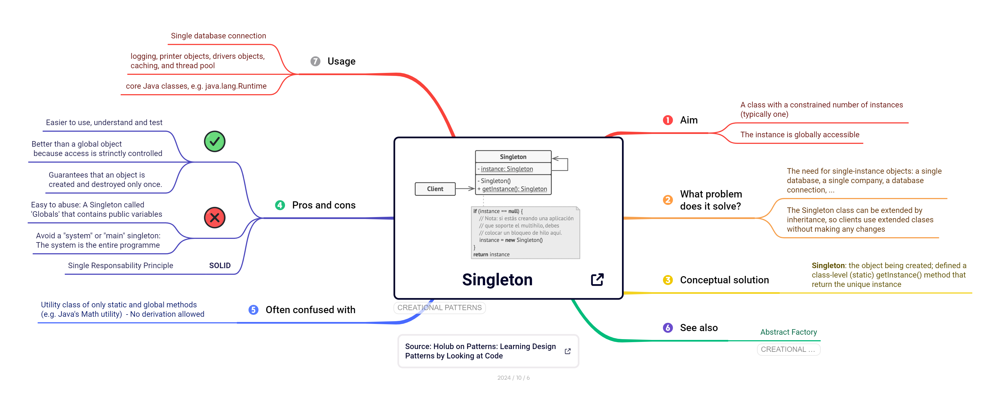

:::


::: {.callout-tip title="Implementación"}

{width=25} [Singleton en Java (refactoring.guru)](https://refactoring.guru/es/design-patterns/singleton/java/example#lang-features)

:::


### Builder


Cuando un objeto tiene muchos atributos, varios de ellos opcionales, su constructor acaba recibiendo una lista interminable de parámetros, que dificulta la gestión de nuevas instancias. El patrón *Builder* propone **construir el objeto paso a paso**, mediante un objeto constructor (*builder*) con un método para cada parte. Además, el mismo proceso de construcción puede producir representaciones distintas: por ejemplo, el mismo informe generado en HTML o en PDF.


| Propósito |  Problema |
|-----------|-----------|
| crea objetos complejos separando el proceso de **construcción de su representación** | ... porque tengo clases constructoras con muchos argumentos y con cierto grado de opcionalidad  |


::: column-screen-inset-right
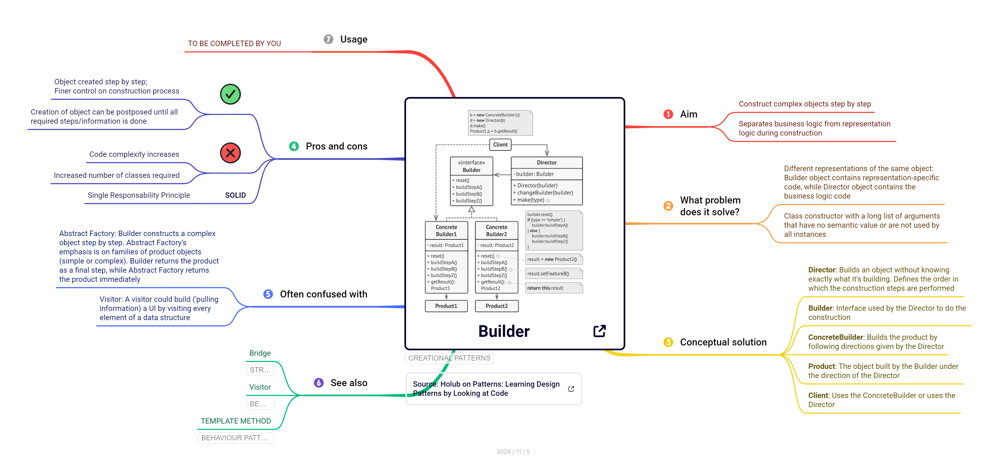
:::


::: {.callout-tip title="Implementación"}

{width=25} [Builder en Java (refactoring.guru)](https://refactoring.guru/es/design-patterns/builder/java/example#lang-features)

:::


### Prototype


En ocasiones, crear un objeto desde cero resulta costoso (requiere consultas a una base de datos, cálculos largos o una configuración compleja) o simplemente queremos obtener una copia exacta de un objeto ya existente. Copiarlo "desde fuera" no siempre es posible, porque parte de su estado puede ser privado y el código cliente quedaría atado a su clase concreta. El patrón *Prototype* delega la copia en el propio objeto: cada prototipo sabe **clonarse a sí mismo**, de modo que el cliente puede crear objetos nuevos a partir de otros ya configurados sin conocer su clase.

| Propósito | Problema |
|---|---|
| crea objetos nuevos **copiando (clonando) objetos existentes** sin depender de sus clases concretas | … porque crear el objeto desde cero es costoso o quiero copias de objetos ya configurados |


::: {.callout-tip title="Implementación"}
{width=25} [Prototype en Java (refactoring.guru)](https://refactoring.guru/es/design-patterns/prototype/java/example#lang-features)
:::


### Factory Method


Imagina una aplicación de logística que al principio solo gestiona camiones. Si el código crea los camiones directamente (`new Camion()`), añadir barcos más adelante obligará a modificar muchas partes del programa. El patrón *Factory Method* resuelve este problema sustituyendo la creación directa de objetos por una llamada a un **método de fábrica**, que las subclases pueden redefinir para decidir qué objeto concreto se crea. Así, el código que usa los objetos depende de una interfaz común y no de clases concretas.


| Propósito |  Problema |
|-----------|-----------|
| crea objetos **sin especificar las clases concretas** | ... porque quiero crear objetos especializados en tiempo de ejecución |


::: column-screen-inset-right
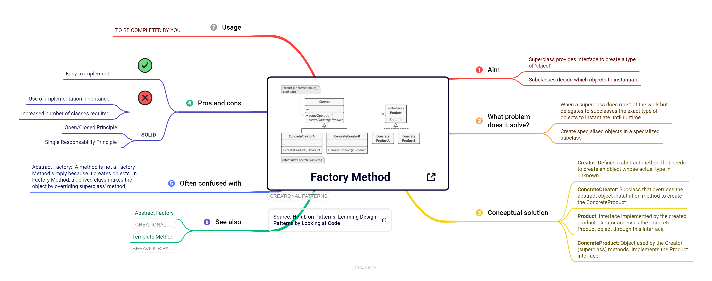
:::


::: {.callout-tip title="Slide Deck"}

[Factory objects & Factory Method pattern](https://cgranell.github.io/ei1039/slides/TE3_factory.html)

:::


::: {.callout-tip title="Implementación"}

{width=25} [Factory Method en Java (refactoring.guru)](https://refactoring.guru/es/design-patterns/factory-method/java/example#lang-features)

:::


### Abstract Factory


A veces no basta con crear un objeto, sino que necesitamos crear **familias de objetos que deben ser compatibles entre sí**. Por ejemplo, una interfaz gráfica con botones, menús y casillas de verificación que deben compartir el mismo estilo (Windows, macOS o Linux). El patrón *Abstract Factory* agrupa en una misma fábrica los métodos que crean cada objeto de la familia, de modo que el cliente obtiene siempre productos coherentes sin conocer sus clases concretas. Puede verse como una generalización de *Factory Method*, aplicada a varios productos relacionados a la vez (en familias).


| Propósito |  Problema |
|-----------|-----------|
| **agrupa factorias** relacionadas temáticamente sin especificar las clases concretas | ... porque quiero crear familias de objetos especializados en tiempo de ejecución |


::: column-screen-inset-right
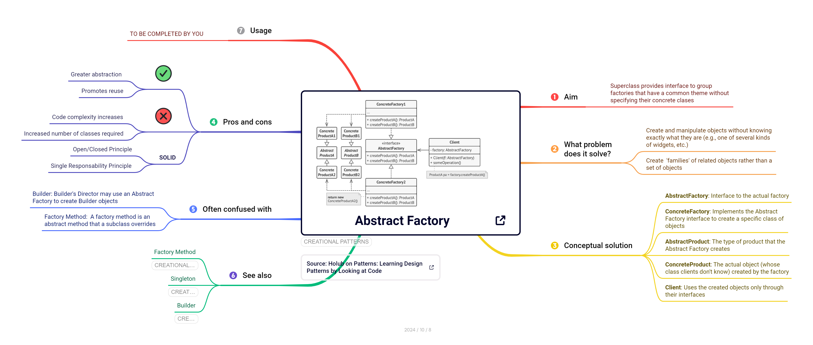
:::

::: {.callout-tip title="Implementación"}

{width=25} [Abstract Factory en Java (refactoring.guru)](https://refactoring.guru/es/design-patterns/abstract-factory/java/example#lang-features)

:::


### Relaciones entre patrones {#relaciones-creacionales}


Los patrones creacionales no son independientes entre sí. A menudo se combinan o uno evoluciona hacia otro a medida que el diseño se vuelve más complejo. Muchos diseños empiezan con *Factory Method*, que es sencillo y fácil de adaptar mediante subclases, y evolucionan hacia *Abstract Factory*, *Prototype* o *Builder* cuando se necesita más flexibilidad. A su vez, las clases de *Abstract Factory* suelen implementarse con métodos de fábrica (*Factory Method*), aunque también pueden apoyarse en *Prototype*. Por último, tanto los patrones *Abstract Factory*, *Builder* y *Prototype* pueden implementarse como *Singleton* cuando basta con una única instancia de ellos.

La @fig-arbol-creacionales recrea un [árbol de decisión](https://medium.com/womenintechnology/stop-memorizing-design-patterns-use-this-decision-tree-instead-e84f22fca9fa?sk=d8ce25c71ba530c026c9b90e9c8d38f0) que resume cuándo conviene utilizar cada patrón creacional.


```{mermaid}
%%| label: fig-arbol-creacionales
%%| fig-cap: "Árbol de decisión para elegir un patrón creacional"
%%| echo: false
flowchart TD
  A["¿Qué problema tengo al crear objetos?"] --> B{"¿Necesito que exista<br/>una única instancia compartida?"}
  B -- Sí --> S["Singleton"]
  B -- No --> C{"¿El objeto es complejo, con muchos<br/>parámetros o pasos de construcción?"}
  C -- Sí --> BU["Builder"]
  C -- No --> D{"¿Crear el objeto desde cero es costoso<br/>o necesito copias de objetos ya configurados?"}
  D -- Sí --> P["Prototype"]
  D -- No --> E{"¿Debo decidir en tiempo de ejecución<br/>qué subclase concreta instanciar?"}
  E -- Sí --> FM["Factory Method"]
  E -- No --> F{"¿Necesito crear familias de objetos<br/>relacionados y compatibles entre sí?"}
  F -- Sí --> AF["Abstract Factory"]
  F -- No --> N["Basta con el constructor:<br/>no hace falta un patrón"]
```

::: {.callout-note title="Un árbol orientativo" icon=true}
Este árbol es una guía, no una regla. En la práctica, un mismo problema puede encajar en varias ramas, y los patrones se combinan entre sí. La última rama es igual de importante que las demás: aplicar un patrón cuando no hace falta añade complejidad sin aportar nada.
:::


## Patrones estructurales

Si los patrones creacionales abordan los problemas derivados de **,a creación de objetivos**, los patrones estructurales responden a la problemática de **cómo se organizan, conectan y combinan  los objetos entre sí**. En un sistema real, las clases no se especifican de forma aislada ni se ejecutan independiente de otras. Siempre existe cierto grado de dependencia entre clases y, sobretodo, existen necesidades de integrar otras clases, externas o no, en el código del sistema a menudo que las necesidades cambian con el tiempo. Por ejemplo, a veces surge la necesidad de incluir librerías externas cuya interfaz no encaja con las clases de nuestro sistema, o sperar o ocultar subsistemas complejos para que sean transparentes a los usuarios, o simplemente se requiren nuevas funcionalidades sin que se deba modificar el código existente.

La idea común que subyace a todos los patrones estructurales es favorecer la [**composición frente a la herencia**](#02_principles.html#favorece-la-composici%C3%B3n-sobre-la-herencia). En lugar de definir jerarquías *estáticas* de clases cada vez más profundas y rígidas en tiempo de diseño, los patrones estructurales facilitan la combinación de clases/objetos de forma *dinámica* cuando la jerarquía estática de clases se convierte en un problema. De esta forma, un objeto **envuelve** a otro, delega trabajo o actúa de intermediario, sin [modificar el resto del programa](#02_principles.html#encapsula-lo-que-var%C3%ADa-y-sep%C3%A1ralo-de-lo-que-no-cambia). De forma conceptual, muchos de estos patrones se basan en un objeto envoltorio (*wrapper*), y la diferencia entre ellos está en el propósito de ese envoltorio.

::: {.column-margin}
¿Maximinar la reutilización de código sin herencia? [Composición sobre herencia](https://en.wikipedia.org/wiki/Composition_over_inheritance). 
:::

::: {.callout-note title="Definición" icon=true}

Los **patrones estructurales** explican cómo combinar clases y objetos para formar estructuras más grandes, manteniéndolas a la vez flexibles y eficientes.

:::


Los patrones estructurales son:

- [Adapter](#adapter)
- [Facade](#facade)
- [Proxy](#proxy)
- [Decorator](#decorator)
- [Composite](#composite)
- [Bridge](#bridge)
- [Flyweight](#flyweight)


### Adapter

Imagina que una aplicación procesa datos en formato [CSV](https://en.wikipedia.org/wiki/Comma-separated_values) y quieres incorporar una librería de análisis que solo acepta datso en formato [parquet](https://en.wikipedia.org/wiki/Apache_Parquet). Además, no puedes modificar la librería (porque es externa) y tampoco quieres (o puedes) reescribir tu aplicación. El patrón *Adapter* resuelve este problema introduciendo un objeto intermedio, el **adaptador**, que traduce las llamadas de una interfaz a otra, igual que un adaptador de enchufe permite conectar tu teléfono a una toma de corriente de otro país. Así, dos clases con interfaces incompatibles pueden colaborar [sin que ninguna de ellas cambie](https://cgranell.github.io/ei2639/materials/02_principles.html#encapsula-lo-que-var%C3%ADa-y-sep%C3%A1ralo-de-lo-que-no-cambia).


| Propósito |  Problema |
|-----------|-----------|
| permite que clases con **interfaces incompatibles** colaboren...  | ... porque quiero utilizar una clase o librería externa |


::: column-screen-inset-right

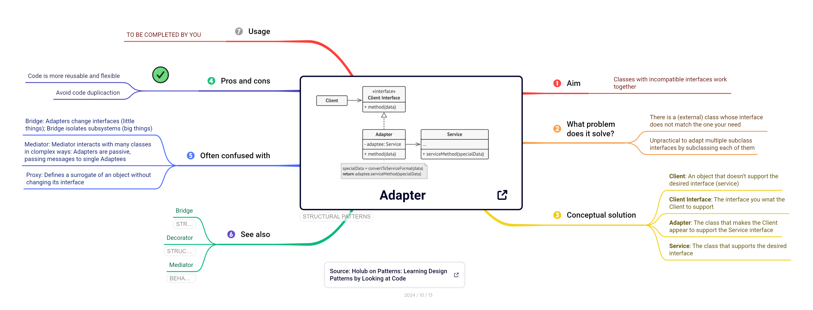

:::


::: {.callout-tip title="Slide Deck"}

[Adapter pattern ](https://cgranell.github.io/ei1039/slides/TE5_adapter.html)

:::


::: {.callout-tip title="Implementación"}

{width=25} [Adapter en Java (refactoring.guru)](https://refactoring.guru/es/design-patterns/adapter/java/example#lang-features)

:::


### Facade 

Cada vez que ejecutas `git commit` estás usando un patrón *Facade*. Internamente, Git distingue entre comandos de bajo nivel, o [*plumbing*](https://git-scm.com/book/en/v2/Git-Internals-Plumbing-and-Porcelain) (fontanería), y comandos de alto nivel, o *porcelain* (porcelana). Un *commit* requiere varios pasos: guardar el contenido de los archivos como objetos (`git hash-object`), construir el árbol de directorios (`git write-tree`), crear el objeto *commit* que apunta a ese árbol (`git commit-tree`) y mover la rama a ese nuevo *commit* (`git update-ref`). Nadie quiere realizar todas estas tareas cada vez que se lleva a cabo un `commit`. El patrón *Facade* ofrece una solución mediante la ideas de fachada: una interfaz sencilla y amigable, como `git commit`, que coordina internamente el subsistema complejo como una serie de comandos de bajo nivel. El usuario solo ve la fachada, aunque podría utilizar los comandos Git de bajo nivel para, por ejemplo, encadenarlos al estilo UNIX en la línea de comandos.


| Propósito |  Problema |
|-----------|-----------|
| **simplifica la interfaz** a un subsistema... | ... porque quiero ocultar la complejidad de un subsistema a los clientes |


::: column-screen-inset-right

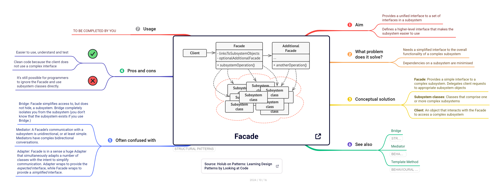

:::

::: {.callout-tip title="Slide Deck"}

[Facade pattern](https://cgranell.github.io/ei1039/slides/TE5_facade.html)

:::


::: {.callout-tip title="Implementación"}

{width=25} [Facade en Java (refactoring.guru)](https://refactoring.guru/es/design-patterns/facade/java/example#lang-features)

:::


### Proxy


A veces no queremos que el cliente acceda directamente a un objeto. Puede que sea un objeto costoso (una imagen de gran tamaño, o un objeto que requiere de mucho cómputo para instanciarse), que haya que comprobar permisos antes de usarlo, o que convenga guardar en caché sus resultados. El patrón *Proxy* propone un objeto **sustituto** con el mismo interfaz que el objeto real. El cliente cree que trabaja con el objeto original, pero realmente interactua con el objeto *proxy* que controla el acceso y puede hacer tareas adicionales antes y/o después de delegar en o interaccionar con el objeto real. En definitiva, el patrón *Proxy* permite **suplantar o sustituir** un objeto real.


| Propósito |  Problema |
|-----------|-----------|
| **suplanta** recursos reales de forma transparente al cliente... | ... porque quiero introducir restricciones de acceso o reducir coste |


::: column-screen-inset-right

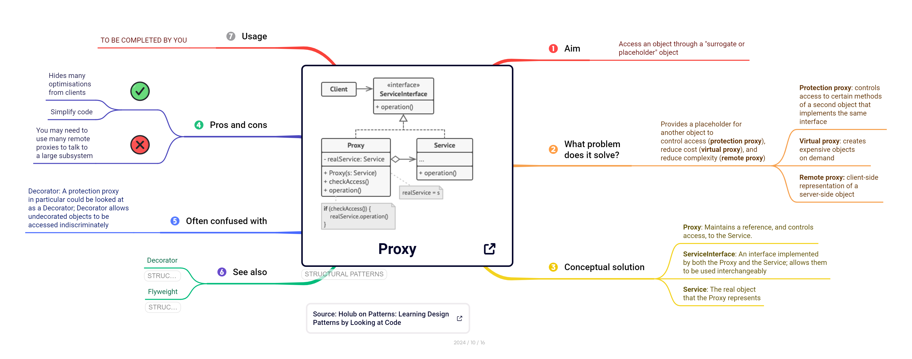

:::

::: {.callout-tip title="Slide Deck"}

[Proxy pattern](https://cgranell.github.io/ei1039/slides/TE5_proxy.html)

:::


::: {.callout-tip title="Implementación"}

{width=25} [Proxy en Java (refactoring.guru)](https://refactoring.guru/es/design-patterns/proxy/java/example#lang-features)

:::


### Decorator

Imagina un sistema de notificaciones que envía avisos por correo electrónico. Más adelante, algunos usuarios quieren recibirlos también por SMS, mientras que otros por Slack y, para complicar las cosas, hay otro grupo de usuarios que recibe notificaciones por las tres vías a la vez. Crear una subclase para cada combinación es inviable. El patrón *Decorator* permite **añadir responsabilidades a un objeto de forma dinámica**, envolviéndolo en uno o varios *decoradores* que comparten la misma interfaz. Cada decorador añade un comportamiento específico (por ejemplo, enviar por SMS) y delega el resto en el objeto que envuelve, como quien se pone capas de ropa según el tiempo que haga.

Los decoradores de Python son otro ejemplo ilustrativo, ya que también se inspiran en el patrón *Decorator*, pero no son exactamente lo mismo, porque envuelven funciones y no objetos que comparten una interfaz. La sintaxis `@` permite añadir comportamiento a una función in Python sin modificar su código. Por ejemplo, `@functools.lru_cache` añade una caché de resultados a cualquier función, de modo que una función recursiva como Fibonacci deja de recalcular los mismos valores una y otra vez. Del mismo modo, podrías escribir un decorador `@medir_tiempo` que monitorize la ejecución o un decorador `@requiere_login` que compruebe permisos de acceso, y aplicar varios a la vez secuencialmente. Esta es la idea del patrón *Decorator*: **envolver** un objeto (en este ejemplo de Python, una función) en otro que añade una responsabilidad y delega el resto en el objeto original. Así, los comportamientos se añaden, se quitan o se combinan sin tocar el código del objeto envuelto.

::: {.column-margin}
 Echa un vistazo a las [functools — Higher-order functions](https://docs.python.org/3/library/functools.html) para averiguar más sobre los entresigos de los decoradores en Python.
:::

| Propósito |  Problema |
|-----------|-----------|
| **añade** nuevas reponsabilidades/comportamientos a objetos | ... porque quiero añadirlos, quitarlos, o agregarlos dinámicamente |


::: column-screen-inset-right

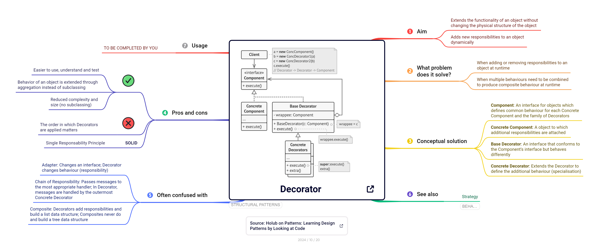

:::

::: {.callout-tip title="Slide Deck"}

[Decorator pattern](https://cgranell.github.io/ei1039/slides/TE6_decorator.html)

:::

::: {.callout-tip title="Implementación"}

{width=25} [Decorator en Java (refactoring.guru)](https://refactoring.guru/es/design-patterns/decorator/java/example#lang-features)

:::


### Composite


Muchas abstraciones o modelos de datos se estructuran en forma de **árbol**: un sistema de archivos contiene carpetas que a su vez contienen archivos y otras carpetas; un pedido contiene productos y cajas que a su vez contienen más productos. Si el código tiene que distinguir en cada paso si trata de un objeto simple (un fichero) o de un objeto contenedor (una carpeta), se llena de condicionales y resulta más difícil su mantenimiento. Para resolver este problema, el patrón *Composite* define una interfaz común para los elementos simples (las hojas) y los compuestos (los contenedores), de modo que para el cliente todos los nodos son del mismo tipo. Por ejemplo, para calcular el tamaño de un elemento compuesto (una carpeta) basta con pedirle su tamaño, y el objeto compuesto se lo pide recursivamente a sus objetos hijos (ficheros incluidos en la carpeta).

Relacionado con las asignaturas de compiladores y estructuras de datos, piensa en cómo un compilador o una calculadora evalúa la expresión `(3 + 4) * 5`. Primero la convierte en un [**árbol de sintaxis abstracta**](https://en.wikipedia.org/wiki/Abstract_syntax_tree) (AST): los números son los **nodos hojas** y las operaciones (`+`, `*`) son los **nodos intermedios** que contienen otras expresiones. Si el compilador tuviera que comprobar en cada paso si está ante un número o ante una operación, resultaría en un código muy engorroso. El patrón *Composite* define una interfaz común, `Expresion`, con un método `evaluar()`, que deben implementar tanto los números (nodos hojas) como las operaciones (nodos intermedios). Un número simplemente devuelve su valor; una suma pide a sus dos nodos hijos que se evalúen y suma los resultados. Así, al tener la misma interfaz, evaluar la expresión completa se reduce a una sola llamada: `raiz.evaluar()`, y la recursión hace el resto.


| Propósito |  Problema |
|-----------|-----------|
| **manipula** jerarquías de objetos somo si fueran de solo un tipo ... | ... porque quiero tratar objetos individuales y compuestos de la misma forma |


::: column-screen-inset-right

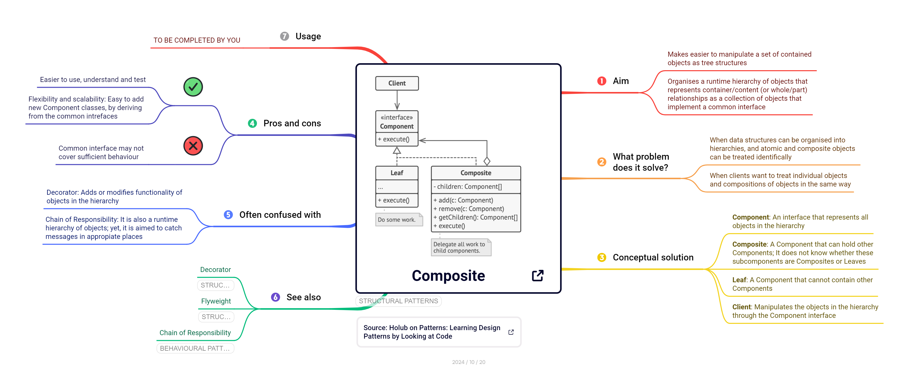

:::


::: {.callout-tip title="Slide Deck"}

[Composite pattern](https://cgranell.github.io/ei1039/slides/TE6_composite.html)

:::


::: {.callout-tip title="Implementación"}

{width=25} [Composite en Java (refactoring.guru)](https://refactoring.guru/es/design-patterns/composite/java/example#lang-features)

:::


### Bridge

Imagina que programas un bot que envía distintos tipos de mensajes (texto, imágenes y encuestas) a cada una de las plataformas de mensajería: Discord, Telegram y Slack. Con herencia, se necesita una subclase (implementación) para cada combinación mensaje-plataforma (`EncuestaDiscord`, `ImagenTelegram`, `TextoSlack`...): nueve clases para tres mensajes y tres plataformas, y cada nueva plataforma obliga a añadir tres clases más. El problema es que el diseño crece en dos dimensiones independientes: qué se envía y por dónde se envía. El uso del patrón *Bridge* separa esos dos subsistemas en jerarquías distintas, uno para la **abstracción** (el tipo de mensaje) y otro para la **implementación** (la plataforma), conectados mediante un *puente* (*bridge*) que combina abstracciones e implementaciones dinámicamente. Cada mensaje sabe **qué** contenido enviar y delega en la plataforma **cómo** enviarlo. Añadir, por ejemplo, una nueva plataforma (e.g., WhatsApp) supone únicamente añadir una nueva clase al subsistema de implementación únicamente, y no una clase por cada tipo de mensaje disponible. Es decir, la jerarquía de clases para el subsistema de implementación evoluaciona sin afectar al código relativo al subsistema de abstracción.


| Propósito |  Problema |
|-----------|-----------|
| **separa subsistemas**... | ... porque puede que un subsistema cambie completamente sin que eso afecte al otro subsistema |


::: column-screen-inset-right

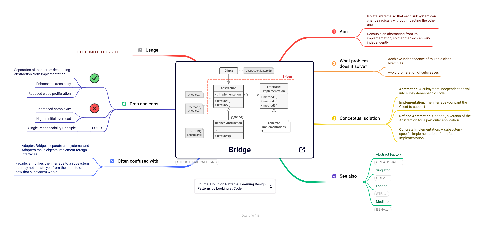

:::


::: {.callout-tip title="Implementación"}

{width=25} [Bridge en Java (refactoring.guru)](https://refactoring.guru/es/design-patterns/bridge/java/example#lang-features)

:::


### Flyweight

Ahora imagina un videojuego que recrea un bosque de cien mil árboles. Si cada árbol guarda su propia copia del modelo 3D del árbol, las texturas y la animación del viento, el juego necesitaría enormes cantidades de memoria solo para gestionar la vegetación. Sin embargo, en realidad solo hay unos pocos tipos de árbol (pino, roble, abeto); lo que cambia de uno a otro es su posición, su tamaño y su rotación. El patrón *Flyweight* separa el estado de cada objeto en dos partes. El **estado intrínseco** (el modelo y las texturas de cada tipo de árbol) es compartido e inmutable y se almacena una sola vez. El **estado extrínseco** (posición, escala, rotación) es propio de cada instancia de los objetos `árbol`. Así, miles de objetos *ligeros* comparten una copia del mismo estado. 

::: {.column-margin}
Los motores gráficos utilizan el patrón *Flyweight* con la técnica de [*instancing*](https://en.wikipedia.org/wiki/Geometry_instancing), que permite a la GPU dibujar miles de copias de un mismo modelo en una sola operación.
:::

Abre una consola de Python y prueba lo siguiente:

```python
a = int("256")
b = int("256")
print(a == b, a is b)   # True True

a = int("257")
b = int("257")
print(a == b, a is b)   # True False
```

En ambos casos los valores son iguales (`==` devuelve `True`), pero con `256` las dos variables apuntan **al mismo objeto** (`is` devuelve `True`), y con `257` no. La razón es que CPython, la implementación habitual de Python, crea al arrancar los objetos de los enteros entre -5 y 256 y los guarda en una **caché**. Como estos números se usan constantemente (índices, contadores, bucles...), en lugar de crear un objeto nuevo cada vez que aparecen, el intérprete devuelve siempre la misma instancia compartida. A partir de 257, cada valor se crea como un objeto independiente.

Python aplica la misma idea a las cadenas de texto mediante el [*string interning*](https://github.com/python/cpython/blob/main/InternalDocs/string_interning.md): muchas cadenas cortas (como los nombres de variables o las claves de los diccionarios) se almacenan una sola vez, y el programador puede forzarlo con `sys.intern()`:


```python
import sys

s1 = "".join(["hola", "mundo"])
s2 = "".join(["hola", "mundo"])
print(s1 is s2)                          # False: dos objetos distintos
print(sys.intern(s1) is sys.intern(s2))  # True: una única instancia compartida
```

Esta es la idea del patrón *Flyweight*: cuando un programa necesita muchos objetos **idénticos e inmutables**, se **comparte una única instancia** en lugar de crear miles de copias, lo que ahorra memoria y tiempo de creación. La [inmutabilidad](https://en.wikipedia.org/wiki/Immutable_object) es la clave: si un objeto compartido pudiera modificarse, el cambio afectaría a todos los que lo usan. En términos del patrón, la caché de enteros actúa como una **fábrica de *flyweights* **: antes de crear un objeto, comprueba si ya existe uno igual y, en ese caso, lo reutiliza.


| Propósito |  Problema |
|-----------|-----------|
| **construye objetos ligeros** que comparten estado... | ... porque tengo problemas de memoria al tener muchos objetos similares |


::: column-screen-inset-right

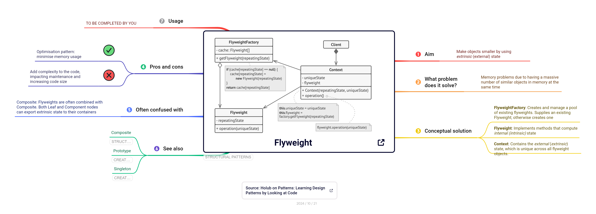
:::

::: {.callout-tip title="Implementación"}


{width=25} [Flyweight en Java (refactoring.guru)](https://refactoring.guru/es/design-patterns/flyweight/java/example#lang-features)

:::
 
 
 
### Relaciones entre patrones {#relaciones-estructurales}


Varios patrones estructurales tienen una estructura muy parecida, porque todos *envuelven* un objeto, pero se distinguen por su intención:

- *Adapter* cambia la interfaz de un objeto existente. *Decorator* la mantiene, pero añade comportamiento. *Proxy* también la mantiene, pero controla el acceso al objeto real.
- *Adapter* hace utilizable la interfaz de *un* objeto. *Facade* define una interfaz nueva y simplificada para *todo un subsistema*.
- *Bridge* se diseña desde el principio, para que abstracción e implementación evolucionen por separado. *Adapter* se aplica a posteriori, para encajar piezas que ya existen.
- *Composite* y *Decorator* se basan en la composición recursiva de objetos. La diferencia es que un decorador envuelve a *un único* objeto para añadirle funciones, mientras que un compuesto agrupa a *varios* hijos para realizar una operación con sus resultados.
- *Flyweight* puede usarse para compartir las hojas de un árbol *Composite* y ahorrar memoria.
- Como basta con una única fachada por subsistema, *Facade* se implementa a menudo como *Singleton*.

La @fig-arbol-estructurales recrea un [árbol de decisión](https://medium.com/womenintechnology/stop-memorizing-design-patterns-use-this-decision-tree-instead-e84f22fca9fa?sk=d8ce25c71ba530c026c9b90e9c8d38f0) que resume cuándo conviene utilizar cada patrón estructural.


```{mermaid}
%%| label: fig-arbol-estructurales
%%| fig-cap: "Árbol de decisión para elegir un patrón estructural"
%%| echo: false
flowchart TD
  A["¿Qué problema tengo al <br/>combinar objetos/clases?"] --> B{"¿Quiero compatibiliar<br/> clases incompatibles?"}
  B -- Sí --> AD["Adapter"]
  B -- No --> C{"¿Quiero ofrecer una interfaz simple<br/>a un subsistema complejo?"}
  C -- Sí --> FA["Facade"]
  C -- No --> D{"¿Necesito controlar el acceso a un objeto<br/>(carga diferida, permisos, caché)?"}
  D -- Sí --> PR["Proxy"]
  D -- No --> E{"¿Quiero añadir o quitar comportamiento<br/>a un objeto en tiempo de ejecución?"}
  E -- Sí --> DE["Decorator"]
  E -- No --> F{"¿Trabajo con estructuras en árbol donde<br/>partes y todo deben tratarse igual?"}
  F -- Sí --> CO["Composite"]
  F -- No --> G{"¿Una clase varía en dos dimensiones<br/>independientes y la herencia se dispara?"}
  G -- Sí --> BR["Bridge"]
  G -- No --> H{"¿Tengo muchísimos objetos similares<br/>que consumen demasiada memoria?"}
  H -- Sí --> FL["Flyweight"]
  H -- No --> N["No hace falta un patrón:<br/>basta con una composición sencilla"]
```

::: {.callout-note title="Un árbol orientativo"}
Igual que con los patrones creacionales, este árbol es una guía y no una regla. Un mismo problema puede encajar en varias ramas, y los patrones estructurales se combinan con frecuencia (por ejemplo, *Composite* con *Decorator*, o *Composite* con *Flyweight*).
:::


## Patrones de comportamiento

Si los patrones creacionales responden a la pregunta *¿cómo se crean los objetos?* y los estructurales a *¿cómo se organizan y conectan?*, los patrones de comportamiento responden a un tercer problema bastante común en ingeniería de software: **¿quién hace qué, y cómo se comunican los objetos para conseguirlo?** En un sistema real, los objetos y clases colaboran constantemente: un objeto avisa a otros de un cambio, otro decide qué algoritmo aplicar, otro guarda un estado para poder deshacer una acción a posteriori. Si esa colaboración y asignación de responsabildiades no se diseña de forma adecuada, aparecen síntomas caractetristicos del código de baja calidad (alto acoplamiento, baja cohesión, o bajo nivel de reutilización) . Los objetos saben demasiado unos de otros, los métodos se llenan de condicionales `if`/`else` o `switch` interminables y cualquier cambio en una clase obliga a modificar muchas otras.

La idea común a casi todos estos patrones es **tratar y convertir un comportamiento como un objeto**. Una petición se convierte en un objeto en *Command*, un algoritmo en *Strategy*, un estado en *State*, una forma de recorrer una colección en *Iterator* y una instantánea del estado de un objeto en *Memento*. Una vez que el comportamiento deseado se estructura como un objeto, éste puede guardarse, intercambiarse, combinarse o pasarse a otros objetos. Un cliente de una petición queda **desacoplado** del objeto que finalmente la atiende. Los patrones de commportamiento aplican los [principios básicos de diseño](02_principles.qmd#principios-de-la-programaci%C3%B3n-orientada-a-objetos-poo) vistos anteriormente: encapsular lo que varía, programar a una interfaz y favorecer la composición sobre la herencia. Todo esto facilita que el software resultante sea de **alta cohesión**, que es lo que queremos como ingenieros/as de software.

::: {.callout-note title="Definición" icon=true}

Los **patrones de comportamiento** se ocupan de la comunicación entre objetos en tiempo de ejecución, es decir, de los roles que asumen los objetos, de cómo se reparten las responsabilidades y de cómo interactúan entre sí.

:::

Los patrones de comportamiento son:

- [Command](#command)
- [Memento](#memento)
- [Chain of Responsibility](#chain-of-responsibility)
- [Template Method](#template-method)
- [Observer](#observer)
- [Strategy](#strategy)
- [Mediator](#mediator)
- [Iterator](#iterator)
- [State](#state)
- [Interpreter](#interpreter)


### Command

En un editor de código, la acción "copiar" puede iniciarse desde el menú, desde un botón de la barra de herramientas, con `Ctrl+C` o desde la paleta de comandos. Si cada uno de esos elementos contiene su propia lógica, el código se hace más compleja de forma innecesaria. Además, resulta más  difícil implementar funciones como **deshacer** (`Ctrl+Z`) o repetir la última acción, si depende del origen que la desencadeno. El patrón *Command* encapsula cada petición en un **objeto comando**, con un método `ejecutar()` y, opcionalmente, otro `deshacer()`. Así, los botones, menús y atajos solo saben que deben ejecutar un comportamiento determinado (un comando), sin conocer qué hace. Como las peticiones son objetos, pueden guardarse en un historial, ponerse en una cola para ejecutarse más tarde o enviarse a otra aplicación. 


| Propósito | Problema |
|-----------|----------|
| permite encapsular una petición como un objeto... | ... porque quiero tener mayor control sobre el ciclo de vida de dicha petición (deshacer, encolar, registrar, repetir) |


::: column-screen-inset-right

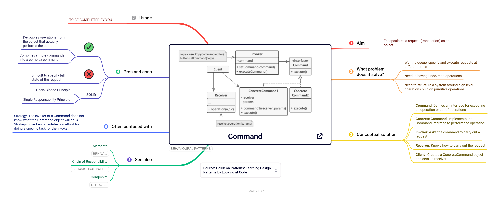

:::


::: {.callout-tip title="Slide Deck" icon=false}

[Command pattern](https://cgranell.github.io/ei1039/slides/TE8_command.html)

:::


::: {.callout-tip title="Implementación"}

{width=25} [Command en Java (refactoring.guru)](https://refactoring.guru/es/design-patterns/command/java/example#lang-features)

:::


### Memento

Piensa por un momento en cómo se almacena una partida en un videojuego. EN cada moemento, el videojuego necesita una instantánea del estado del personaje (posición, vida, inventario...) para poder restaurarla más tarde. Sin embargo, si cualquier clase pudiera leer y modificar libremente esos atributos, se rompería la [encapsulación](https://en.wikipedia.org/wiki/Encapsulation_(computer_programming)) y cualquiera podría hacer trampas. El patrón *Memento* resuelve este problema haciendo que sea el **propio objeto** (el *originador*) quien genere una instantánea de su estado, el *memento*. Otro objeto, el *cuidador* (por ejemplo, el sistema de partidas guardadas), almacena los mementos sin poder ver ni modificar su contenido. Cuando hace falta, el originador recibe un memento y restaura su estado a partir de él.


| Propósito | Problema |
|-----------|----------|
| permite capturar el estado de un objeto sin violar su encapsulación... | ... porque quiero restaurar ese estado en cualquier momento |


::: column-screen-inset-right

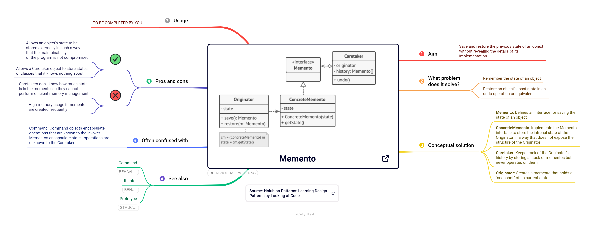


:::

::: {.callout-tip title="Implementación"}

{width=25} [Memento en Java (refactoring.guru)](https://refactoring.guru/es/design-patterns/memento/java/example#lang-features)

:::


### Chain of responsibility


Cuando una petición HTTP llega a una aplicación web, antes de llegar a la función que la atiende suele pasar por varios filtros. Uno registra la petición en el *log*, otro comprueba que el usuario ha iniciado sesión, otro limita el número de peticiones por minuto y otro descomprime los datos. Si todas esas comprobaciones estuvieran en un único método, sería enorme y difícil de modificar. El patrón *Chain of Responsibility* organiza los gestores en una **cadena**: cada eslabón decide si procesa la petición, si la rechaza o si la pasa al siguiente. Es exactamente lo que hacen los [*middleware*](https://docs.djangoproject.com/es/stable/topics/http/middleware/) de frameworks como [Django](https://www.djangoproject.com/), [Express](https://expressjs.com/) o [Spring Boot](https://docs.spring.io/spring-boot/). Así, se pueden añadir, quitar o reordenar eslabones sin modificar el resto de la cadena.

| Propósito | Problema |
|-----------|----------|
| permite distribuir la responsabilidad de una petición entre una cadena de gestores... | ... porque tengo un número variable de objetos que pueden gestionarla |


::: column-screen-inset-right

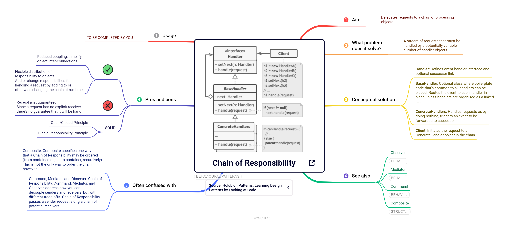

:::

::: {.callout-tip title="Implementación"}

{width=25} [Chain of Reponsibility en Java (refactoring.guru)](https://refactoring.guru/es/design-patterns/chain-of-responsibility/java/example#lang-features)

:::


### Template method  


Si has escrito pruebas unitarias con `unittest` en Python o con [JUnit](https://junit.org/) en Java, ya has usado este patrón sin saberlo. El *framework* define el algoritmo general que se sigue al ejecutar cada prueba: preparar el entorno (`setUp`), ejecutar la prueba y limpiar al terminar (`tearDown`). Tú solo redefines los pasos que te interesan en tu subclase, y el *framework* se encarga del resto. Eso es el patrón *Template Method*: una superclase define el **esqueleto de un algoritmo** en un método (la *plantilla*) y deja que las subclases redefinan algunos de sus pasos sin cambiar la estructura general. Se evita así duplicar la parte común del algoritmo en cada subclase (es decir, las implementacones concretas).

| Propósito | Problema |
|-----------|----------|
| define el esqueleto de un algoritmo a nivel de superclase... | ... pero permite que las subclases sobrescriban partes del algoritmo |


::: column-screen-inset-right

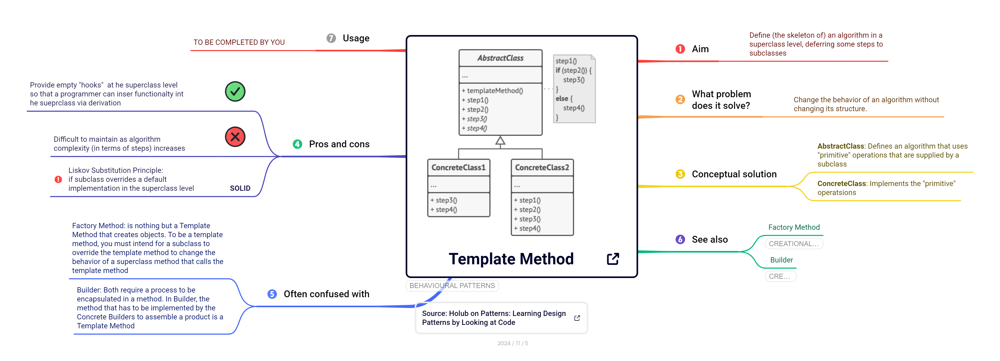

:::

::: {.callout-tip title="Slide Deck"}

[Template Method pattern](https://cgranell.github.io/ei1039/slides/TE7_templatemethod.html)

:::


::: {.callout-tip title="Implementación"}

{width=25} [Template Method en Java (refactoring.guru)](https://refactoring.guru/es/design-patterns/template-method/java/example#lang-features)

:::


### Observer

Cuando te suscribes a un canal de YouTube o activas las notificaciones de un repositorio de GitHub, no tienes que comprobar cada cinco minutos si hay novedades: es el canal quien te avisa cuando publica algo. El patrón *Observer* aplica esta misma idea entre objetos. Un objeto, el **sujeto**, mantiene una lista de objetos **observadores** suscritos y les notifica automáticamente cada vez que cambia su estado. Los observadores pueden suscribirse o darse de baja en cualquier momento, y el sujeto no necesita conocer sus clases concretas. Es el mecanismo que hay detrás de los eventos en las interfaces gráficas (`addEventListener` en JavaScript), de las hojas de cálculo que recalculan las celdas dependientes y de los *frameworks* reactivos, como sucede en los notebooks [marimo](https://github.com/navneet-mkr/marimo-observability) o [observable](https://observablehq.com/).

| Propósito | Problema |
|-----------|----------|
| define un mecanismo de suscripción sobre un objeto (sujeto)... | ... porque hay un número variable de objetos observadores que dependen de sus cambios |


::: column-screen-inset-right

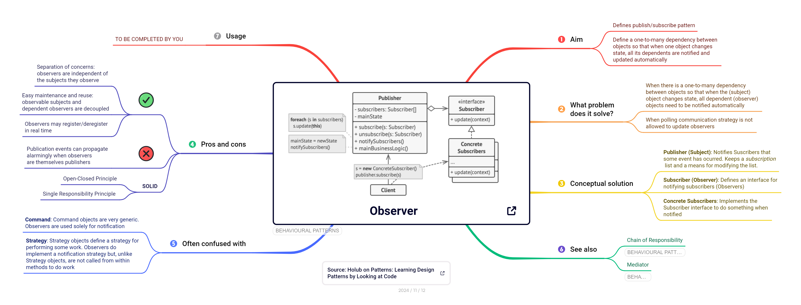

:::

::: {.callout-tip title="Slide Deck"}

[Observer pattern](https://cgranell.github.io/ei1039/slides/TE6_observer.html)

:::

::: {.callout-tip title="Implementación"}

{width=25} [Observer en Java (refactoring.guru)](https://refactoring.guru/es/design-patterns/observer/java/example#lang-features)

:::


### Strategy

Una aplicación de navegación como Google Maps calcula rutas distintas según vayas en coche, a pie, en bicicleta o en transporte público. Si todos esos algoritmos estuvieran en una sola clase, controlados por un gran `if`/`else`, cada nuevo medio de transporte obligaría a modificarla y aumentaría el riesgo de errores. El patrón *Strategy* considera cada algoritmo como si fuera un objeto/clase, la **estrategia**, y todas las estrategias comparten una interfaz común. El objeto principal, el *contexto*, guarda una referencia a la estrategia activa para delegarle llevar a cabo el trabajo, de modo que se puede slecioar otra estrategia en tiempo de ejecución. 


| Propósito | Problema |
|-----------|----------|
| permite seleccionar un método/algoritmo en tiempo de ejecución... | ... porque hay diferentes algoritmos intercambiables para resolver un mismo problema |


Un ejemplo que ya conoces es el argumento `key` de `sorted()` en Python, que permite cambiar el criterio de ordenación sin modificar el algoritmo de ordenación.


::: column-screen-inset-right

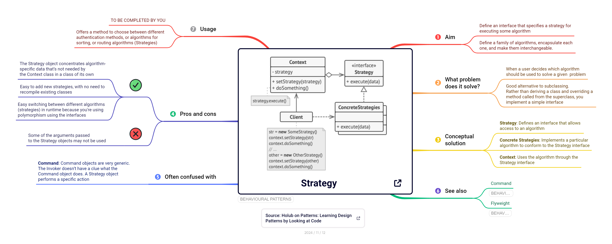

:::

::: {.callout-tip title="Slide Deck"}

[Strategy pattern](https://cgranell.github.io/ei1039/slides/TE7_strategy.html)

:::

::: {.callout-tip title="Implementación"}

{width=25} [Strategy en Java (refactoring.guru)](https://refactoring.guru/es/design-patterns/strategy/java/example#lang-features)

:::


### Mediator

En un aeropuerto, los aviones no se comunican directamente entre sí para decidir quién aterriza primero: todos hablan con la **torre de control**, que coordina el tráfico. Si cada avión tuviera que negociar con todos los demás, el sistema sería caótico. Lo mismo ocurre en un formulario de registro: marcar una casilla activa un campo de texto, elegir un país cambia la lista de provincias y el botón "Enviar" solo se habilita si todo es correcto. Si cada componente conoce y modifica directamente a los demás, el resultado es una red de dependencias cruzadas difícil de mantener (el llamado [código *spaguetti*](https://en.wikipedia.org/wiki/Spaghetti_code)). El patrón *Mediator* introduce un objeto **mediador** que centraliza la comunicación: los componentes solo hablan con él, y es el mediador quien decide a quién avisar.


| Propósito | Problema |
|-----------|----------|
| encapsula las comunicaciones/interacciones entre objetos... | ... para evitar dependencias directas y código *spaguetti* |


::: column-screen-inset-right

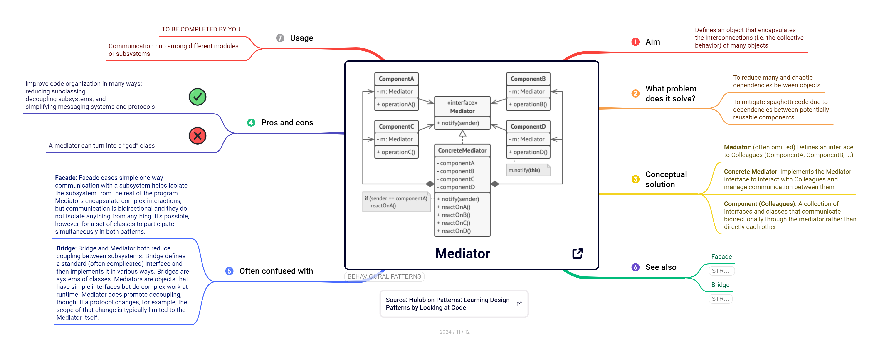

:::


::: {.callout-tip title="Implementación"}

{width=25} [Mediator en Java (refactoring.guru)](https://refactoring.guru/es/design-patterns/mediator/java/example#lang-features)

:::


### Iterator


Como vimos anteriormente, el bucle `for` de Python funciona igual con una lista, un diccionario, un archivo de texto o un rango de números, aunque cada uno guarde sus datos de forma muy distinta. Esto es posible gracias al patrón *Iterator*, que extrae la lógica de recorrido de una colección a un objeto aparte, el **iterador**. El iterador sabe cuál es el siguiente elemento y cuándo se ha terminado el recorrido de la coleción. En Python, cualquier objeto que implemente los métodos `__iter__()` y `__next__()` puede recorrerse con `for`, y los generadores (`yield`) permiten crear iteradores con muy poco código. Así, el cliente recorre cualquier colección de la misma forma, sin conocer su estructura interna (una lista, un árbol, una tabla *hash*...).

| Propósito | Problema |
|-----------|----------|
| proporciona un mecanismo de acceso a los elementos de una colección sin exponer su estructura/representación interna... | ... porque tengo diferentes tipos de colecciones y quiero acceder de forma homogénea a todas |


::: column-screen-inset-right

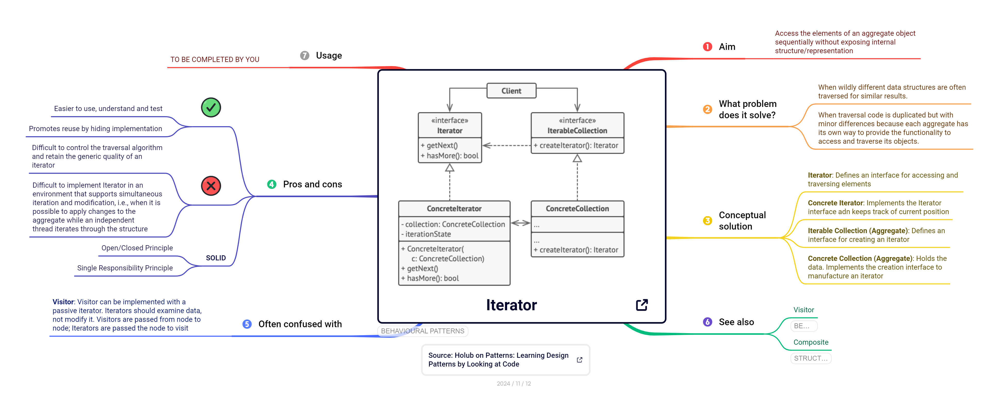

:::

::: {.callout-tip title="Slide Deck"}

[Iterator pattern](https://cgranell.github.io/ei1039/slides/TE8_iterator.html)

:::


::: {.callout-tip title="Implementación"}

{width=25} [Iterator en Java (refactoring.guru)](https://refactoring.guru/es/design-patterns/iterator/java/example#lang-features)

:::


### State

Piensa en una petición *pull request* (PR) de GitHub: puede estar en borrador, abierta, en revisión, aprobada, fusionada o cerrada, y en cada estado las mismas acciones se comportan de forma distinta. Por ejemplo, no se puede fusionar una *pull request* en borrador, y una ya fusionada no puede volver a revisarse. Si este comportamiento se implementa con condicionales (`if estado == "borrador": ... elif estado == "abierta": ...`), cada método se llena de ramas y cada estado nuevo obliga a revisarlos todos. El patrón *State* aplica la idea de las [máquinas de estados finitos](https://en.wikipedia.org/wiki/Finite-state_machine) que conoces de otras asignaturas. Cada estado se convierte en una **clase** con su propio comportamiento, y el objeto principal (el *contexto*) delega en su estado actual. Cuando el estado cambia, el objeto *parece cambiar de clase*.


| Propósito | Problema |
|-----------|----------|
| permite que un objeto cambie su comportamiento cuando cambia su estado interno... | ... porque tengo muchos condicionales que dependen del estado del objeto y cada nuevo estado obliga a modificarlos todos |


::: {.callout-tip title="Implementación"}
{width=25} [State en Java (refactoring.guru)](https://refactoring.guru/es/design-patterns/state/java/example#lang-features)
:::


### Interpreter


 
### Relaciones entre patrones {#relaciones-comportamiento}


Los patrones de comportamiento se combinan con frecuencia, y varios tienen estructuras tan parecidas que es fácil confundirlos:

- *Command y Memento.* Juntos permiten implementar **deshacer**. El comando ejecuta la acción y, antes de hacerlo, guarda un memento con el estado anterior para poder restaurarlo.
- *Strategy y State.* Ambos se basan en la composición y la delegación, y sus diagramas son casi idénticos. La diferencia está en la intención. En *Strategy*, el cliente elige el algoritmo y las estrategias no se conocen entre sí. En *State*, los propios estados se conocen y deciden cuándo pasar de uno a otro.
- *Strategy y Template Method.* Ambos permiten variar partes de un algoritmo. *Template Method* lo hace mediante **herencia**: se decide al escribir el código y afecta a toda la clase. *Strategy* lo hace mediante **composición**: se decide en tiempo de ejecución y afecta a cada objeto.
- *Observer y Mediator.* *Observer* establece suscripciones dinámicas de **uno a muchos**. *Mediator* centraliza en un solo objeto las comunicaciones de **muchos a muchos**. Ambos se combinan a menudo: un mediador puede implementarse como sujeto al que se suscriben los componentes.
- *Chain of Responsibility, Command, Mediator y Observer.* Los cuatro conectan a quien envía una petición con quien la recibe, pero de forma distinta. *Chain* la pasa de eslabón en eslabón, *Command* la encapsula en un objeto, *Mediator* centraliza la comunicación y *Observer* permite suscribirse y darse de baja dinámicamente.
- *Iterator y Composite.* Un iterador permite recorrer un árbol *Composite* sin conocer su estructura. Además, *Iterator* puede apoyarse en *Memento* para guardar la posición actual del recorrido y retomarla después.
- *Interpreter y Composite.* El árbol de expresiones de *Interpreter* es, en realidad, un *Composite*: las expresiones terminales son las hojas y las no terminales son los nodos compuestos.

La @fig-arbol-comportamiento recrea un [árbol de decisión](https://medium.com/womenintechnology/stop-memorizing-design-patterns-use-this-decision-tree-instead-e84f22fca9fa?sk=d8ce25c71ba530c026c9b90e9c8d38f0) que resume cuándo conviene utilizar cada patrón de comportamiento.

```{mermaid}
%%| label: fig-arbol-comportamiento
%%| fig-cap: "Árbol de decisión para elegir un patrón de comportamiento"
%%| echo: false
flowchart TD
  A["¿Qué problema tengo en la colaboración<br/>entre objetos?"] --> B{"¿Quiero tratar una petición como un objeto<br/>(deshacer, encolar, registrar)?"}
  B -- Sí --> CM["Command"]
  B -- No --> C{"¿Necesito guardar y restaurar el estado<br/>de un objeto sin romper su encapsulación?"}
  C -- Sí --> ME["Memento"]
  C -- No --> D{"¿Varios objetos pueden atender una petición<br/>y no sé de antemano cuál lo hará?"}
  D -- Sí --> CR["Chain of Responsibility"]
  D -- No --> E{"¿Varios objetos deben enterarse<br/>automáticamente de los cambios de otro?"}
  E -- Sí --> OB["Observer"]
  E -- No --> F{"¿Muchos objetos se comunican entre sí<br/>y las dependencias se cruzan?"}
  F -- Sí --> MD["Mediator"]
  F -- No --> G{"¿El comportamiento de un objeto<br/>cambia según su estado interno?"}
  G -- Sí --> ST["State"]
  G -- No --> H{"¿Hay varios algoritmos intercambiables<br/>para una misma tarea?"}
  H -- "Sí, elegidos en ejecución" --> SG["Strategy"]
  H -- "Sí, comparten un esqueleto común" --> TM["Template Method"]
  H -- No --> I{"¿Necesito recorrer colecciones distintas<br/>de la misma forma?"}
  I -- Sí --> IT["Iterator"]
  I -- No --> J{"¿Debo evaluar expresiones de un<br/>lenguaje o gramática sencillos?"}
  J -- Sí --> IN["Interpreter"]
  J -- No --> N["No hace falta un patrón:<br/>basta con una colaboración directa"]
```


::: {.callout-note title="Un árbol orientativo"}
Igual que en las secciones anteriores, este árbol es una guía y no una regla. Los patrones de comportamiento se combinan con frecuencia (*Command* con *Memento*, *Mediator* con *Observer*, *Iterator* con *Composite*), y un mismo problema puede encajar en varias ramas.
:::


