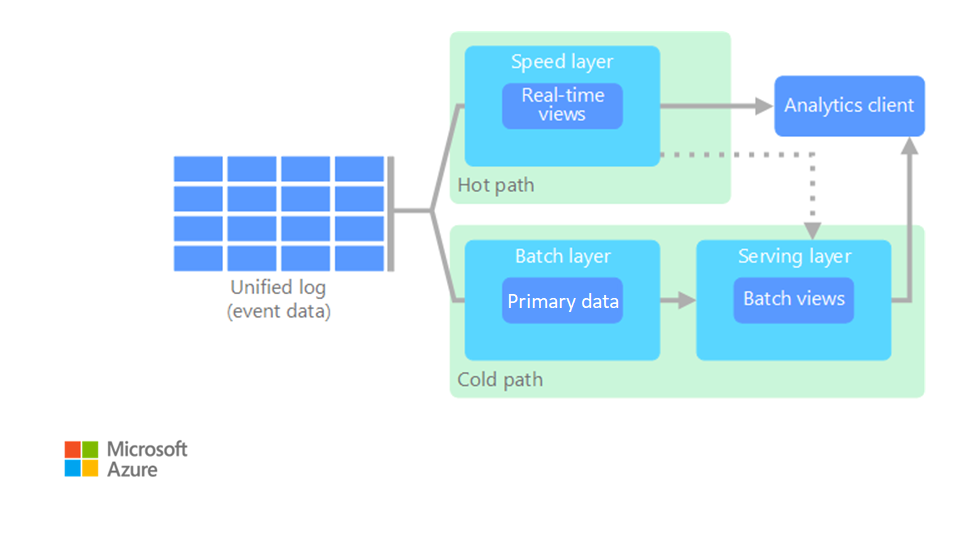

# Patrones de arquitectura de datos


Como señala [@heck2024_dataengineering], la **ingeniería de datos** es 

> "el desarrollo, la implementación y el mantenimiento de sistemas y procesos que toman datos en crud y producen información consistente y de alta calidad que soporta casos de uso posteriores, como el análisis y el aprendizaje automático" [@reis2022], citado en [@heck2024_dataengineering].

La ingeniería de datos es la disciplina que diseña, construye y mantiene los sistemas, infraestructuras y arquitecturas que permiten recopilar, almacenar, transformar y poner a disposición los datos de una organización para su análisis y uso operativo. Combina principios de ingeniería de software, arquitectura de sistemas y gestión de datos para garantizar que la información *fluya* de manera fiable desde las fuentes originales hasta los usuarios finales, ya sean éstos otros sistemas o aplicaciones (modelos IA, applicaciones de negocio, dashboards), personal especializado (analistas, científicos de datos) o el público en general.

Por lo tanto, la ingeniería de datos, como disciplina, no va de trasladar, mover, o copiar datos de un sistema a otro. El perfil del ingeniero/a de datos se encarga de diseñar y construir arquitecturas de datos escalables, fiables, seguras, rentables y preparadas para la analítica y la IA. Sus tareas incluyen, entre otras, el diseño de *workflows* de captura y transformación de datos, la especificacion de modelos de datos óptimos, la gobernanza de los datos, o la calidad de los datos.

A medida que organizaciones y entidades adoptan la computación y plataformasen la nube, analítica en tiempo real, productos de datos y aplicaciones o modelos dirigidas por la IA, comprender los **patrones de arquitectura de datos** (por ejemplo, [@aais2026]) es una habilidad primordial Al igual que los patrones de diseño de software, los patrones de arquitectura de datos ofrecen soluciones probadas a problemas recurrentes, ya sean éstos la integración de fuentes de datos heterogéneas, servir datos a baja latencia, o garantizar la trazabilidad de los datos.


En la [sección anterior](04_cloud_data_formats.html) vimos los formatos de datos optimizados para la nube (Parquet y afines): columnar, comprimidos, con esquema explícito y evolución de esquema. Podríamos decir que estos formatos optimizados son los *ladrillos* y que los patrones de arquitectura de datos son los *planos*: deciden cómo se combinan esos ladrillos en un sistema completo, es decir, dónde se almacenan los datos, cómo se procesan, cómo se organizan y especifica aspectos de gobernanza a nivel de toda una organización.

Para no perder el hilo entre los siguiente seis patrones de arquitectura de datos y entender el role que desempeñan a un nivel alto de abstracción, los agrupamos en tres bloques:

- **Bloque A — Almacenamiento:** ¿dónde y con qué esquema guardamos los datos? (*ETL* → *Data Lake*)
- **Bloque B — Procesamiento:** ¿cómo equilibramos latencia y precisión entre análisis por lotes y en tiempo real? (*Lambda* → *Kappa*)
- **Bloque C — Organización y gobernanza:** ¿cómo estructuramos y definimos la gobernaza de lso datos a escala de organización? (*Medallion* → *Data Product*)

Cada bloque depende conceptualmente del anterior: el Bloque C se apoya en las decisiones de almacenamiento del Bloque A (*medallion* es, de hecho, una forma de organizar capas en un *data lake*), mientras que el Bloque B es una dimensión relativamente independiente (aplica tanto si el almacenamiento final es, por ejemplo, un *warehouse* como si es un *data lake*).


## Bloque A — Almacenamiento: de ETL a Data Lake

Este bloque hace refernecia al cambio de paradigma más antiguo de la ingeniería de datos: del esquema fijo definido antes de cargar los datos (*schema-on-write*), al almacenamiento de datos en crudo con el esquema aplicado al leer o consumir (*schema-on-read*). Esta transición fue posible en gran medida al abaratamiento del almacenamiento en la nube y a los formatos da datos optimizados como parquet.

### ETL Architecture

*ETL architecture* es el patrón clásico de tres fases orientado aa consultas analíticas estructuradas (BI/reporting): 

- *Extract*: extracción de datos desde fuentes y/o sistemas de origen
- *Transform*: limpieza, integración, agregación  y validación de los datos en un esquema determinado (*schema-on-write*) 
- *Load*: carga de los datos en un data warehouse con un esquema relacional fijo, optmizado para cierto tipo de consultas 

En la práctica, ETL se encuentra detrás de los data warehouses empresariales de sectores clásicos como venta al por menor, banca o seguros [@kimball2004]. 

{fig-alt="ETL architecture" fig-align="center" width="80%"}

*Source: [Azure Architecture Center, "Extract, transform, and load (ETL)"](https://learn.microsoft.com/en-us/azure/architecture/data-guide/relational-data/etl)*


::: {.callout-note appearance="simple" title="Para profundizar"}

- *The Data Warehouse ETL Toolkit: Practical Techniques for Extracting, Cleaning, Conforming, and Delivering Data* [@kimball2004]
- Kimball Group, ["ETL Architecture's 34 Subsystems"](https://www.kimballgroup.com/data-warehouse-business-intelligence-resources/kimball-techniques/etl-architecture-34-subsystems/) — describe el desglose práctico de los subsistemas de un ETL real.
:::

### Data Lake Architecture


El patrón *Data Lake Architecture* hace referencia a un repositorio centralizado que almacena datos en formato nativo o original (*schema-on-read*) en infraestructuras de la nube (mediante objetos de almacenamiento tipo Amazon S3) usando formatos orientados a columna como Parquet. A diferencia del patrón ETL, el esquema de los datos se decide al consumir el dato (*schema-on-read*), no en el momento de almacenarlo. Uber realizó una implementacion real a gran escala en su data lake transaccional sobre [Apache Hudi](https://hudi.apache.org/) (también desarrollado intermante por Uber) para facilitar  procesamiento incremental a escala de billones de registros de datos, evitando reescribir particiones completas en cada actualización.


::: {.callout-note appearance="simple" title="Para profundizar"}
- ["Pentaho, Hadoop, and Data Lakes"](https://jamesdixon.wordpress.com/2010/10/14/pentaho-hadoop-and-data-lakes/)[@dixon2010] - entrada de blog original que acuña el término.
- [@azzabi2024]
- Uber Engineering, ["Uber's Lakehouse Architecture"](https://www.uber.com/us/en/blog/ubers-lakehouse-architecture/) — caso práctico con Apache Hudi.
:::

## Bloque B — Procesamiento: batch vs. tiempo real

El segundo bloque aborda el "cuándo": ¿cómo servimos resultados con baja latencia sin renunciar a la precisión inherente cuando se analiza todo el histórico de datos? *Lambda* y *Kappa* son dos respuestas a la misma pregunta. Y *Kappa* solo se entiende *como una reacción a* paliar una deficiencia de la arquitectura *Lambda*.

### Lambda Architecture


El patrón *Lambda Architecture* combina dos capas o rutas paralelas sobre los mismos datos: 

- capa **batch**: procesa todo el histórico, alta precisión, alta latencia.
- capa **speed/streaming**: proceso datos recientes, baja latencia, resultados aproximados. 

Ambas vistas de datos se combinan y unifican en una capa **serving** para dar servicio a consulta analíticas. El coste aquí es mantener y sincronizar las dos capas de entrada de datos. En [@marz2015], el [capítulo 1](https://manning-content.s3.amazonaws.com/download/3/4142054-00c8-4115-879e-946c643f3665/big-data-ch01.pdf) describe un ejemplo práctico en Twitter que combina [Apache Hadoop](https://hadoop.apache.org/) (batch) con [Apache Storm](https://storm.apache.org/) (streaming).

{fig-alt="Lambda architecture" fig-align="center" width="80%"}

*Source: [Azure Architecture Center, "Big data architectures"](https://learn.microsoft.com/en-us/azure/architecture/databases/guide/big-data-architectures)*


::: {.callout-note appearance="simple" title="Para profundizar"}
- [@marz2015]
:::

### Kappa Architecture


El patrón *Kappa* simplifica *Lambda* eliminando la capa batch. Todo el procesamiento de datos, tanto histórico como en tiempo real, pasa por un único fluho d eprocesamiento de datos en streaming. Normalmente, la integración de los datos históricos se realiza a posteriore, reanalizando el log de eventos (p. ej., [Apache Kafka](https://kafka.apache.org/)) en lugar de mantener una segunda capa de código. Por ejemplo, LinkedIn adoptó una architectura  *Kappa* basada enteramente en el procesamineto de datos en streaming para evitar la duplicidad de lógica de *Lambda*.


{fig-alt="Lambda architecture" fig-align="center" width="80%"}

*Source: [Azure Architecture Center, "Big data architectures"](https://learn.microsoft.com/en-us/azure/architecture/databases/guide/big-data-architectures)*


::: {.callout-note appearance="simple" title="Para profundizar"}

- [@kreps2014]
- [@lin2017] - comparación crítica y más académica de ambos patrones.

:::

## Bloque C — Organización y gobernanza de datos

Este último bloque no trata únicamente de decisiones de almacenamiento o procesamiento de los datos, como en los dos bloques anteriores, sino que incluye aspectos como la **organización y gobernanza** de los datos a escala de toda una organización. *Medallion* sigue operando dentro del *data lake* del Bloque A (es, de hecho, una forma de ordenar sus capas de calidad); *Data Product/Data Mesh* es el patrón más reciente y de mayor nivel de abstracción.

### Medallion Architecture


El patrón *Medallion Architecture* organiza los datos dentro de un data lake/lakehouse en capas progresivas de calidad: 

- *Bronze*: datos en crudo, tal como llegan
- *Silver*: datos limpios, validados y conformados
- *Gold*: datos agregados, listos para consumo de negocio/BI/ML

Suele utlizar formatos transaccionales tipo Delta Lake [@armbrust2020] o [Apache Iceberg](https://iceberglakehouse.com/iceberg/iceberg-medallion-architecture/) construidos sobre Parquet. Este es el patrón de referencia en prácticamente todos los casos de cliente publicados por [Databricks](https://www.databricks.com/).


```{mermaid}
%%| fig-align: center
%%| echo: false
flowchart LR
  A[Fuentes de datos] --> B[Bronze - Datos crudos]
  B --> C[Silver - Limpios y conformados]
  C --> D[Gold Agregados, listos para BI/ML]
```


::: {.callout-note appearance="simple" title="Para profundizar"}
- Databricks, ["What is the medallion lakehouse architecture?"](https://docs.databricks.com/aws/en/lakehouse/medallion) [@databricks_medallion].
- Databricks, [documentación de Delta Lake](https://docs.databricks.com/aws/en/delta/) — el formato transaccional que suele sustentar Medallion en producción.
- [@armbrust2020] - Delta Lake
:::


### Data Product Architecture

El patrón *Data Product Architecture* (o [*Data Mesh*](https://en.wikipedia.org/wiki/Data_mesh)) se distingue de los anteriores por ser más conceptual y organizativo. Aquó, los datos se tratan como **productos**, con propietarios de dominio (*domain ownership*), descubribles y de autoservicio, con con una gobernanza  federada. [Intuit](https://www.intuit.com/) (empresa de fintech) documentó su migración a data mesh con equipos de dominio propietarios de sus propios datos.

```{mermaid}
%%| fig-align: center
%%| echo: false
flowchart TB
  subgraph Dominio A
    DPA[Data Product A]
  end
  subgraph Dominio B
    DPB[Data Product B]
  end
  subgraph Dominio C
    DPC[Data Product C]
  end
  DPA <--> DPB
  DPB <--> DPC
  DPA <--> DPC
```

*Source: propia; inspirado de [How to Move Beyond a Monolithic Data Lake to a Distributed Data Mesh](https://martinfowler.com/articles/data-monolith-to-mesh.html)*

::: {.callout-note appearance="simple" title="Para profundizar"}
- Data Mesh: Delivering Data-Driven Value at Scale [@dehghani2022]
- Intuit, ["Intuit's Data Mesh"](https://www.slideshare.net/TristanBaker2/intuits-data-mesh-data-mesh-leaning-community-meetup-5132021) — charla pública en Data Mesh Learning Community (2021). [#intuit2021]
:::

